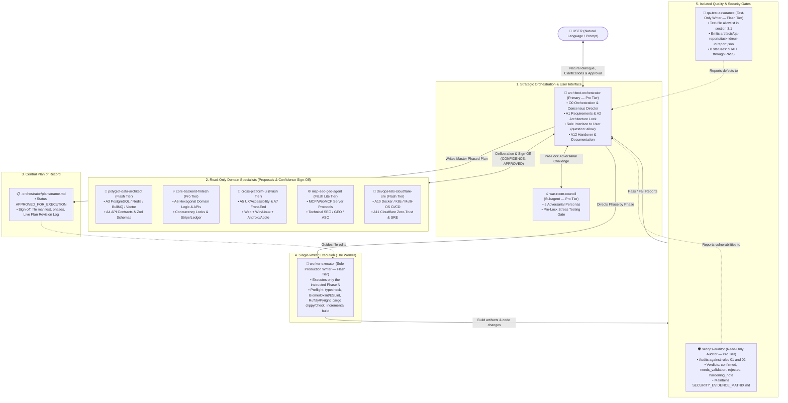
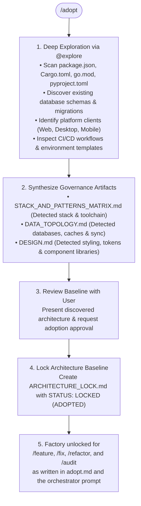
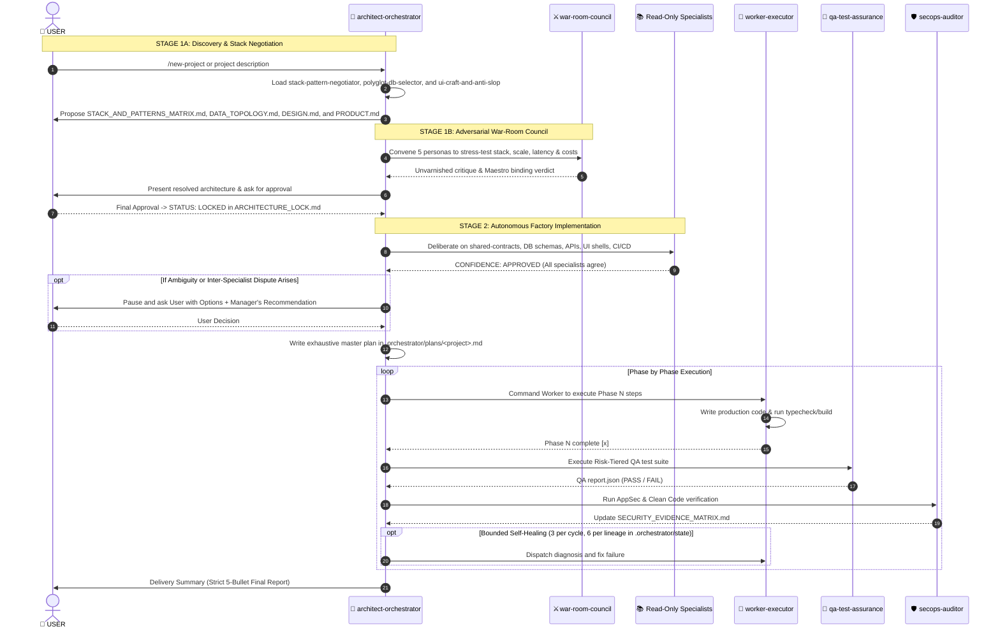
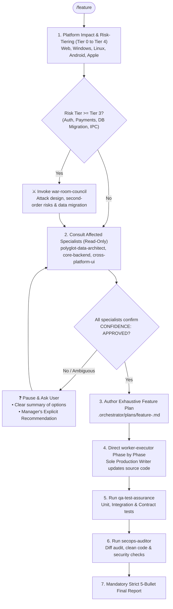
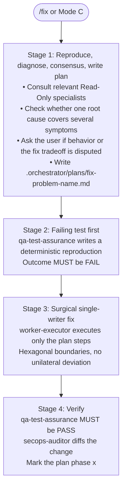
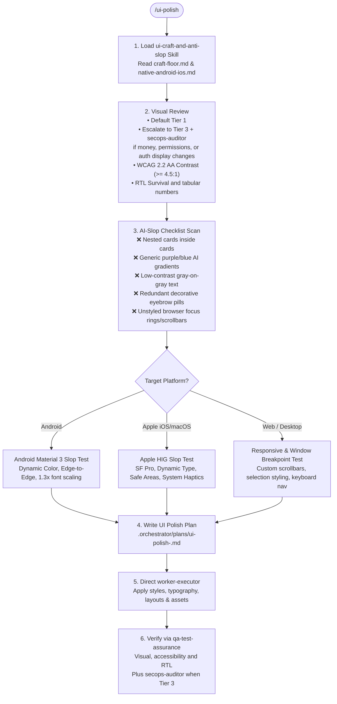
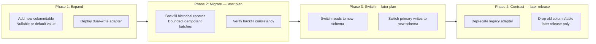

# OpenCode Project-Ready Configuration Package (10 Custom Factory Agents + 4 Preserved Built-In Agents)

Copy **`opencode.json`**, **`AGENTS.md`**, and **`.opencode/`** into the root of the target project. Do not copy this `README.md` or `.git/`. The tree below matches the files in this repository. OpenCode then runs the **Contract-Driven Autonomous Software Factory** across **Web + Windows + Linux + Android + Apple (iOS/macOS)**.

---

## 1. Ready-to-Copy Directory Structure (Project-Local)

Simply copy **`opencode.json`**, **`AGENTS.md`**, and the **`.opencode/`** folder from here and paste them directly into the root directory of your target project (e.g., `D:\MyProject\`):

```text
<Your-Project-Root>/
├── opencode.json                        # default_agent, instructions 01+02, policies, global permissions, built-in agent overrides
├── AGENTS.md                            # Project Constitution & Non-Compactable Policy Packet (v3.0)
└── .opencode/                           # Hidden OpenCode project folder containing all agents, skills, commands, and rules
    ├── rules/
    │   ├── 01-clean-code-policy.md          # Clean Code & Hexagonal Architecture Policy (sections 0–22, including the 7-day dependency cooldown)
    │   ├── 02-cross-platform-security-policy.md # Cross-Platform Security Policy (Web, API, Win, Linux, Android, Apple)
    │   ├── 03-functional-test-assurance-policy.md # Isolated Functional QA Policy (15 Sections + JSON Schema 1.0 + 8 States)
    │   └── 04-universal-seo-ai-search-policy.md # Universal SEO, AI Search (GEO), MCP/WebMCP & App Store (ASO) Policy
    ├── agents/                          # 10 Custom Factory Agents (Alongside OpenCode's 4 Built-In Default Agents)
    │   ├── architect-orchestrator.md        # (Primary — Pro Tier) Chief Orchestrator O0 + A1 + A2 + A12
    │   ├── worker-executor.md               # (Subagent — Flash Tier) "The Worker": Sole production file writer
    │   ├── war-room-council.md              # (Subagent — Pro Tier) 5-Persona Adversarial Red-Team Council
    │   ├── polyglot-data-architect.md       # (Subagent — Flash Tier, Read-Only Planner) Data & Contracts Architect A3 + A4
    │   ├── core-backend-fintech.md          # (Subagent — Pro Tier, Read-Only Planner) Backend, Concurrency & FinTech Ledger Architect A6
    │   ├── cross-platform-ui.md             # (Subagent — Flash Tier, Read-Only Planner) 5-Platform UI/UX Architect A5 + A7
    │   ├── mcp-seo-geo-agent.md             # (Subagent — Flash Lite Tier, Read-Only Planner) MCP/WebMCP & SEO/GEO/ASO Specialist
    │   ├── devops-k8s-cloudflare-sre.md     # (Subagent — Flash Tier, Read-Only Planner) DevOps, K8s & Multi-OS CI/CD Architect A10 + A11
    │   ├── qa-test-assurance.md             # (Subagent — Flash Tier, Test-Only Writer) Isolated QA Verifier A9
    │   └── secops-auditor.md                # (Subagent — Pro Tier, Read-Only Auditor) AppSec & Clean Code Gatekeeper A8
    ├── skills/                          # Specialized Agent Skills (Loaded dynamically on demand)
    │   ├── stack-pattern-negotiator/SKILL.md
    │   ├── war-room-debate/SKILL.md
    │   ├── polyglot-db-selector/SKILL.md
    │   ├── clean-hexagonal-enforcer/SKILL.md
    │   ├── docker-k8s-cicd-blueprint/SKILL.md
    │   ├── ui-craft-and-anti-slop/
    │   │   ├── SKILL.md
    │   │   └── references/
    │   │       ├── craft-floor.md
    │   │       └── native-android-ios.md
    │   └── deep-security-hunting/
    │       ├── SKILL.md
    │       └── references/
    │           ├── desktop-mobile-ipc-attacks.md
    │           └── ai-and-tenant-isolation.md
    └── commands/                        # 11 Custom Slash Commands inside OpenCode TUI
        ├── adopt.md                         # /adopt       (Mode 0: Adopt existing brownfield repository)
        ├── new-project.md                   # /new-project (Mode A: Greenfield project build)
        ├── feature.md                       # /feature     (Mode B: Contract-delta feature evolution)
        ├── fix.md                           # /fix         (Mode C: 4-stage surgical TDD bug fix)
        ├── ui-polish.md                     # /ui-polish   (Eliminate AI-slop, enforce WCAG & native craft)
        ├── refactor.md                      # /refactor    (Behavior-preserving clean-code refactoring)
        ├── migrate.md                       # /migrate     (Tier 4 zero-downtime DB migration)
        ├── audit.md                         # /audit       (Full QA & AppSec Red-Team audit gate)
        ├── release.md                       # /release     (Pre-flight verification & release packaging)
        ├── resume.md                        # /resume      (Resume in-progress or interrupted plan)
        └── war-room.md                      # /war-room    (child session: agent war-room-council, subagent: true)
```

### Keeping Agent Configs Out of Git (`.gitignore`)
If you want to use this agent system inside a project **without committing agent configuration files to that project's Git repository**, add these lines to your target project's `.gitignore` (or `.git/info/exclude`):

This package does not ship a `.gitignore`. The block below is a suggestion for the **target** project only.

```gitignore
# OpenCode Local Agent Factory & Orchestrator Artifacts
.opencode/
.orchestrator/
.worktrees/
opencode.json
AGENTS.md
artifacts/qa-reports/
artifacts/secops-reports/
```

`.worktrees/` is created by the orchestrator's worktree protocol (`git worktree add .worktrees/<task>-<agent> HEAD`). `.orchestrator/` already covers plans (`.orchestrator/plans/`) and repair counters (`.orchestrator/state/<lineage>.json`).

---

## 2. System Architecture & Topology

The Factory implements the **Consensus-Driven Master Plan & Single-Writer Principle**. All domain specialists read and propose architecture in parallel, but **only `worker-executor` writes production code** inside the factory flow, strictly guided by an approved master plan. Switching to the built-in `build` agent with `Tab` is an explicit escape hatch and is outside that rule.



---

## 3. Permission & Responsibility Matrix

Rights are composed by OpenCode V2, not by a single table inside one file. Last matching **permission** rule wins. **Policies** run after permissions and saved approvals and can only tighten access.

Composition order for this package:

1. Shipped agent base policy (every agent starts with `* / * allow`, plus `.env` read `ask`, plus the extra shipped rules for `build`, `plan`, `general`, and `explore`).
2. Global `permissions` in `opencode.json` (appended next).
3. Agent rules, appended last: frontmatter in `.opencode/agents/*.md` for the 10 factory agents, and `agents.<id>.permissions` in `opencode.json` for the 4 built-ins. A later agent `allow` overrides an earlier global permission `deny`.
4. Top-level `policies` (`tool.use`) hard-deny after that. A later policy `allow` only lifts an earlier policy `deny`. It does not grant access by itself. An agent `allow` cannot override a policy `deny`.

`opencode.json` `instructions` loads only `.opencode/rules/01-clean-code-policy.md` and `.opencode/rules/02-cross-platform-security-policy.md` for every agent, after `AGENTS.md`. Rule `03` is cited in the body of `qa-test-assurance.md`, not in `instructions`. Rule `04` is cited in the body of `mcp-seo-geo-agent.md`, not in `instructions`.

`default_agent` is `architect-orchestrator`. No top-level `model` is set. Built-in agents have no `model` key in this package.

### 3.0 Shared denies (exact resources in `opencode.json`)

Global `permissions` (overridable by a later agent rule):

- `external_directory` `*` = `ask` for every agent. No agent frontmatter overrides this.
- Read deny: `*.env`, `*.env.*`, `*.pem`, `*.key`, `*.jks`, `*.keystore`, `*.p8`, `*.p12`, `*.pfx`, `*.mobileprovision`, `*id_rsa*`, `*id_ed25519*`, `*.npmrc`, `*secrets/*`. Later allows: `*.env.example`, `*.env.template`.
- Edit deny: `*.env`, `*.env.*`, `*.pem`, `*.key`, `*.jks`, `*.keystore`, `*.p8`, `*.p12`, `*.pfx`, `*.mobileprovision`, `*secrets/*`, `.opencode/*`, `opencode.json`, `AGENTS.md`. There is no global permission allow for `.env.example` edits.
- Shell deny: `git reset --hard*`, `git checkout -- *`, `git clean*`, `git stash drop*`, `git stash clear*`, `git push*--force*`, `git push* -f*`, `rm -rf /*`, `rm -rf ~*`.
- `subagent` `worker-executor` = `deny`. Only an agent rule that matches later can lift this. In this package, only `architect-orchestrator`'s `subagent: * allow` does that.

`policies` (not overridable by agent rules). These patterns are written as `tool.use` resources `action:value`:

- Shell hard-deny: the permission shell set above, plus `git restore*`, `git checkout -f*`, `git checkout *--force*`, `git switch --discard-changes*`, `git switch *-f*`.
- Read hard-deny: `*.env*` (then `*.env.example*` and `*.env.template*` lift that policy deny only), `*.pem*`, `*.key*`, `*.jks*`, `*.keystore*`, `*.p8*`, `*.p12*`, `*.pfx*`, `*.mobileprovision*`, `*id_rsa*`, `*id_ed25519*`, `*.npmrc*`, `*secrets/*`, `*.ssh/*`, `*.aws/*`.
- Edit hard-deny: `*.env*` (then example/template lift that policy deny only), `*.pem*`, `*.key*`, `*.jks*`, `*.keystore*`, `*.p8*`, `*.p12*`, `*.pfx*`, `*.mobileprovision*`, `*secrets/*`, `.opencode/*`, `opencode.json`, `AGENTS.md`.

Residual gap in the shipped files: neither `permissions` nor `policies` deny **edits** of `*id_rsa*`, `*.npmrc*`, `*.ssh/*`, or `*.aws/*`. Reads of those paths are policy-denied for `.ssh`, `.aws`, `id_rsa`, and `.npmrc`. Do not describe that edit gap as closed.

Each custom agent also repeats the secret **read** deny list in its own frontmatter, then allows `*.env.example` and `*.env.template`.

### 3.1 Per-agent deltas

| Agent | Mode | Edit (frontmatter / package override, last match) | Shell (effective) | Subagent, question, web |
| :--- | :---: | :--- | :--- | :--- |
| **`architect-orchestrator`** | `primary` (default) | `edit *` deny, then allow only `.orchestrator/*`, `ARCHITECTURE_LOCK.md`, `STACK_AND_PATTERNS_MATRIX.md`, `DATA_TOPOLOGY.md`, `DESIGN.md`, `PRODUCT.md`, `docs/adr/*`, `docs/handover.md`. Later denies: `.opencode/*`, `opencode.json`, `AGENTS.md`, `*.env*`. Cannot edit `README.md` or production code. | `shell *` allow, then frontmatter deny of the destructive set (including `git restore*`, `git checkout -f*`, `git switch --discard-changes*`, `git switch *-f*`) and `ask` on `git commit*`, `git push*`, `kubectl *`, `helm *`, `terraform *`, `wrangler *`, `ssh *`, `scp *`, `rsync *`, `alembic *`, `flyway *`, `prisma migrate deploy*`, `gh release *`. Policies still hard-deny destructive Git. | `subagent *` allow. This is the only agent whose rules lift the global `worker-executor` deny. `question *` allow. Web tools stay at the base allow. |
| **`war-room-council`** | `subagent` | `edit *` deny | `shell *` deny | `subagent` deny, `question` deny. Web tools stay at the base allow. |
| **Five planners** (`polyglot-data-architect`, `core-backend-fintech`, `cross-platform-ui`, `mcp-seo-geo-agent`, `devops-k8s-cloudflare-sre`) | `subagent` | Identical frontmatter: `edit *` deny, then `.orchestrator/proposals/*` allow, then deny `.opencode/*`, `opencode.json`, `AGENTS.md`, `*.env*`. | `shell *` allow. That later rule overrides the global **permission** denies for destructive Git. The hard stop is `policies`, not the agent file. | `subagent` deny, `question` deny. Web tools stay at the base allow. |
| **`worker-executor`** | `subagent` | `edit *` allow, then deny secrets, governance (`.orchestrator/*`, the five root governance files, `docs/adr/*`, `docs/handover.md`, `.opencode/*`, `opencode.json`, `AGENTS.md`), `SECURITY_EVIDENCE_MATRIX.md`, `artifacts/secops-reports/*`, `artifacts/qa-reports/*`, and the test globs below. Later allows: `*.env.example`, `*.env.template`. `README.md` is not denied. | `shell *` allow, then frontmatter deny of `git reset --hard*`, `git checkout -- *`, `git clean*`, force-push, stash drop/clear, and `rm -rf`. `ask` on `git commit*`, `git push*`, `kubectl *`, `helm *`, `terraform *`, `wrangler *`, `docker push*`, `prisma migrate deploy*`. No frontmatter ask for `ssh`, `scp`, `rsync`, `alembic`, `flyway`, or `gh release`. `git restore*` / `git switch --discard-changes*` are policy-denied only. | `subagent` deny, `question` deny. `webfetch *` and `websearch *` are `ask`. |
| **`qa-test-assurance`** | `subagent` | `edit *` deny, then allow the test globs below and `artifacts/qa-reports/*`. Later denies: `.opencode/*`, `opencode.json`, `AGENTS.md`, `*.env*`. The agent prompt is narrower than this allowlist: it names `*.test.*`, `*.spec.*`, `tests/`, `__tests__/`, `e2e/`, fixtures, and QA reports only. | `shell *` allow. No destructive-Git denies in the agent file. Policies are the hard stop. | `subagent` deny, `question` deny. `webfetch *` and `websearch *` are `ask`. |
| **`secops-auditor`** | `subagent` | `edit *` deny, then allow `SECURITY_EVIDENCE_MATRIX.md` and `artifacts/secops-reports/*`. Later denies: `.opencode/*`, `opencode.json`, `AGENTS.md`, `*.env*`. | `shell *` allow. No scanner allowlist is pinned in the agent file or in `opencode.json`. `release.md` asks for `pnpm audit`, `cargo audit`, and the 7-day cooldown check. Rule `02` section I2 names Gitleaks and Trivy as supply-chain controls, not as permission resources. | `subagent` deny, `question` deny. Web tools stay at the base allow. Loads `deep-security-hunting` and `clean-hexagonal-enforcer` from the prompt, not from a permission rule. |
| **Built-in `plan`** | `primary` (Tab) | This package adds no edit rules. Shipped plan policy denies project edits except files under `~/.opencode/plan`. | Shipped shell rules, minus global permission denies and policy hard-denies. | Cannot launch `worker-executor` (global deny, not overridden). Shipped policy allows questions. |
| **Built-in `build`** | `primary` (Tab) | Escape hatch for ordinary project files, including tests and `README.md`. This package only adds edit allows for `*.env.example` and `*.env.template`. Still cannot edit `.opencode/*`, `opencode.json`, `AGENTS.md`, or the secret patterns (global permission + policy). | Shipped shell allow, minus global permission denies and policy hard-denies. | Cannot launch `worker-executor`. Can still launch other subagents. Shipped policy allows questions. |
| **Built-in `general`** | `subagent` | This package: `edit *` deny. | This package: `shell *` deny. | Shipped policy denies questions and launching subagents. Global `worker-executor` deny also applies. |
| **Built-in `explore`** | `subagent` | This package: `edit *` deny (also denied by the shipped explore policy). | This package: `shell *` deny. That overrides the shipped explore policy, which otherwise allows shell. | Shipped explore denies every action except shell, read, glob, grep, webfetch, websearch, and `external_directory`. This package removes shell. Question and subagent stay denied. |

QA permission allowlist, which `worker-executor` denies as a matching set: `*.test.ts`, `*.test.tsx`, `*.test.js`, `*.test.jsx`, `*.spec.ts`, `*.spec.tsx`, `*.spec.js`, `*.spec.jsx`, `*_test.go`, `*_test.py`, `*_test.dart`, `*_test.exs`, `*_test.rs`, `*Test.kt`, `*Tests.kt`, `*Test.java`, `*Tests.java`, `*Tests.swift`, `test_*.py`, `conftest.py`, `tests/*`, `*/tests/*`, `__tests__/*`, `*/__tests__/*`, `e2e/*`, `*/e2e/*`, `src/test/*`, `*/src/test/*`, `src/androidTest/*`, `*/src/androidTest/*`, `vitest.config.*`, `playwright.config.*`, `jest.config.*`, `jest.setup.*`, `__snapshots__/*`, `*/__snapshots__/*`, `*.snap`, `fixtures/*`, `*/fixtures/*`. Worker also denies `*Tests/*` and `*UITests/*`, which QA does not allow.

`build` and `plan` are not inside the Single-Writer flow. Switching to `build` with `Tab` is an explicit escape hatch. It does not lift policy denies on factory governance files or secrets.

### 3.2 The Ironclad Git State Acceptance Gate & Safe Worktree Promotion Protocol

This gate is a **process rule** in `architect-orchestrator.md` and `AGENTS.md`. It is not an OpenCode permission and it does not replace the `policies` shell denies in section 3.0. `architect-orchestrator` is instructed to run it before and after every subagent turn:
1. **Pre-Turn Baseline Snapshot:** Records `PRE_HEAD=$(git rev-parse HEAD)`, `PRE_PATCH=$(git diff HEAD)`, and `PRE_UNTRACKED=$(git ls-files --others --exclude-standard)`.
2. **Subagent Execution (Main Workspace or Worktree):**
   - Subagent performs its bounded task.
   - **Parallel Worktree Isolation & Safe Promotion Protocol:** When running concurrent specialist research or experiments, create an isolated worktree:
     `git worktree add .worktrees/<task>-<agent> HEAD`
     Record baseline worktree commit: `PRE_WT_HEAD=$(git -C .worktrees/<task>-<agent> rev-parse HEAD)`.
     Explicitly command the subagent to change directory (`cd .worktrees/<task>-<agent>`) before running commands.
     Post-turn verification inside worktree:
     - **Silent Commit Check:** Confirm `git -C .worktrees/<task>-<agent> rev-parse HEAD == PRE_WT_HEAD`. Any silent commit rejects the phase immediately.
     - **Inspect Both Trees:** Verify both the worktree and the main repository to ensure zero leaked side-effects.
     - **Calculate Worktree Delta:** Compute diff hunks in `git -C .worktrees/<task>-<agent> diff HEAD` against its baseline, plus new untracked files in the worktree.
     - **Ownership Evaluation:** Confirm that modified files match `.orchestrator/proposals/<prefix>-*` only.
     - **Safe Promotion:** Copy accepted proposal files from `.worktrees/<task>-<agent>/.orchestrator/proposals/<prefix>-*` into the main workspace `.orchestrator/proposals/`.
     - **Clean Heavy Build Artifacts:** Purge heavy local build directories (`CARGO_TARGET_DIR`/`target/`, `.gradle/`, `build/`, `node_modules/`).
     - **Process Exit Verification:** Verify no active descendant processes remain.
     - **Safe Worktree Removal:** Remove the worktree using `git worktree remove .worktrees/<task>-<agent>` (without `--force`). If Git rejects removal due to untracked remnants, halt and display the remnants to the user rather than forcing deletion.
3. **Post-Turn Verification (Content Delta Calculation):**
   - **Silent Commit Detection:** Confirms `POST_HEAD == PRE_HEAD`. Any silent commit rejects the phase immediately.
   - **Content-Based Delta Calculation:** Computes `DELTA_CHANGES` = every file path whose diff hunk in `git diff HEAD` changed from `PRE_PATCH` (including pre-dirty files whose content changed or was wiped), plus any path in `git ls-files --others --exclude-standard` not present in `PRE_UNTRACKED`. A pre-existing modified or untracked file is ignored by the gate ONLY if its diff hunk remains completely unchanged; any modification to its content during the turn immediately pulls it into `DELTA_CHANGES` and subjects it to ownership validation.
   - **Ownership Evaluation:** Validates `DELTA_CHANGES` strictly against the Acceptance Gate Ownership Matrix:
     - Specialists: `.orchestrator/proposals/<prefix>-*` only.
     - Worker: Production code and `.env.example`/`.env.template` only (zero tests, zero governance).
     - QA: Test files (`tests/*`, `*/tests/*`, `src/test/*`, `*.test.*`) and `artifacts/qa-reports/*`.
     - SecOps: `SECURITY_EVIDENCE_MATRIX.md` and `artifacts/secops-reports/*`.
     - Orchestrator: Plans (`.orchestrator/plans/*`), governance (`ARCHITECTURE_LOCK.md`, `STACK_AND_PATTERNS_MATRIX.md`, `DATA_TOPOLOGY.md`, `DESIGN.md`, `PRODUCT.md`), and ADRs (`docs/adr/*`, `docs/handover.md`).
     - War-room, `@explore`, and `@general`: **None** (zero file modifications). The orchestrator prompt names all three.
   - Any unowned modification in `DELTA_CHANGES` halts the phase. Untracked unexpected files are purged by name; modified tracked files are presented to the user for decision. The prompt forbids blind `git checkout` or `git reset` of those tracked files.
    - **Permission vs gate mismatch:** This matrix is the text in `architect-orchestrator.md` and `AGENTS.md`. It is narrower than QA's OpenCode allowlist. A write that permissions allow but this matrix does not name (`*.spec.*`, `e2e/*`, `__tests__/*`, `src/androidTest/*`, `*_test.go`, `test_*.py`, `conftest.py`, `*Tests.swift`, Vitest/Playwright/Jest configs, snapshots, `fixtures/*`) is still an ownership failure under the orchestrator prompt. The orchestrator's edit allowlist is `.orchestrator/*`, which is wider than this matrix's `.orchestrator/plans/*` line. Repair counters live at `.orchestrator/state/<lineage>.json` and are written by the orchestrator, not as a subagent delta.
4. **Honest Scope & Escape Hatch:** The gate validates tracked repository changes and prevents silent commits; it does not sandbox the shell process or uncommitted gitignored files. Zero production secrets in development environments is a strict prerequisite. Switching to built-in `build` with `Tab` leaves the Single-Writer flow. `build` still cannot edit `.opencode/*`, `opencode.json`, `AGENTS.md`, or the secret patterns, because those denies are global permissions and policies.

---

## 4. Master Use-Case & Slash Command Matrix

The factory organizes all SDLC workflows into 11 Markdown commands in `.opencode/commands/`. Ten of them set `agent: architect-orchestrator` and omit `subagent`, so OpenCode switches the **current session** to that primary agent and uses its pinned model (`xiaomi-token-plan-ams/mimo-v2.6-pro`). `/war-room` is the exception: `agent: war-room-council` and `subagent: true`, so it runs in a background child and does not switch the parent session or its model.

| Workflow Intent | Slash Command | Orchestrator Mode | Primary Plan / Artifact | Key Gates & Verification |
| :--- | :--- | :---: | :--- | :--- |
| **Brownfield Project Adoption** | `/adopt` | **Mode 0** | `STACK_AND_PATTERNS_MATRIX.md`<br>`DATA_TOPOLOGY.md`<br>`DESIGN.md`<br>`ARCHITECTURE_LOCK.md` | `@explore` scans existing repo -> user approval locks `LOCKED (ADOPTED)`. Unlocks `/feature`, `/fix`, `/refactor`, and `/audit` only (command and orchestrator prompt). |
| **Greenfield Project Build** | `/new-project <vision>` | **Mode A** | `ARCHITECTURE_LOCK.md`<br>`.orchestrator/plans/<project>.md` | Stage 1A Negotiation -> Stage 1B War-Room -> Consensus Sign-Off -> Worker -> QA/SecOps Gates |
| **Feature Evolution / Upgrade** | `/feature <description>` | **Mode B** | `.orchestrator/plans/feature-<name>.md` | 5-Platform Risk Tier (Tier 0–4) -> War-Room (if Tier 3/4) -> Specialist Sign-Off -> Worker -> QA/SecOps Gates |
| **Bug Fixing & Triage** | `/fix <issue/symptoms>` | **Mode C** | `.orchestrator/plans/fix-<name>.md` | 4-Stage Isolated TDD: Multi-symptom triage -> Failing Reproduction Test First -> Single-Writer Fix -> QA PASS |
| **UI Polish & Anti-Slop** | `/ui-polish <target>` | **UI Craft Gate** | `.orchestrator/plans/ui-polish-<name>.md` | Tier 1 by default -> WCAG 2.2 AA, RTL, Anti-Slop, native craft -> QA. Escalate to Tier 3 + `secops-auditor` if money, permissions, or auth display changes |
| **Clean-Code Refactoring** | `/refactor <scope>` | **Refactor Gate** | `.orchestrator/plans/refactor-<name>.md` | Characterization tests pass first -> Clean-Hexagonal refactoring via Worker -> Zero behavioral drift check |
| **Tier 4 DB Migration** | `/migrate <description>` | **Migration Gate** | `.orchestrator/plans/migrate-<name>.md` | Tier 4 design of all four phases. Worker executes **Expand + dual-write only**. Migrate and Switch are later plans. Contract is a subsequent release. User approval before any backfill, switch, or drop |
| **QA & Security Audit** | `/audit [scope]` | **Audit Gate** | `artifacts/qa-reports/<task-id>/<run-id>/report.json`<br>`SECURITY_EVIDENCE_MATRIX.md` | QA + SecOps. If defects are found, `audit.md` writes `.orchestrator/plans/fix-audit-<date>.md` for a later `/fix`. |
| **Release Preparation** | `/release <version>` | **Release Gate** | Release manifest & changelog | QA full suite + SecOps (`pnpm audit`, `cargo audit`, 7-day cooldown). Consult `mcp-seo-geo-agent` and `devops-k8s-cloudflare-sre`. `PLATFORM_REQUIRED` workflow is written by the Worker. User sign-off before version bump, tag, or publish. After that, `ask` still applies to `git commit`, `git push`, and `gh release`. |
| **Resume Interrupted Plan** | `/resume [plan-name]` | **Resume Engine** | Active `.orchestrator/plans/<name>.md` | No argument: newest plan in `.orchestrator/plans/`. Reads `[x]` / `[ ]` and `## 4. Live Plan Revision Log`. Preflight is `git status -s` plus typecheck/build, then Worker resumes the first incomplete step. |
| **Adversarial Critique** | `/war-room <decision>` | **Stage 1B Gate** | War-room child transcript (no plan file is required by `war-room.md`) | Runs `war-room-council` as a child (`subagent: true`). Five personas: Engineer, Devil's Advocate, Cynical User, Domain Expert, Maestro. Does not switch the parent to the orchestrator. |

### Command and lock rules that the files actually state

- **Architecture lock gate** (`architect-orchestrator.md` preflight): if `ARCHITECTURE_LOCK.md` is absent or `STATUS: DRAFT`, production-code plans for Mode B, `/refactor`, `/migrate`, `/ui-polish`, and `/release` are not authored. Route to Mode 0 or Mode A Stage 1A first. Mode C (`/fix`) and `/audit` may proceed on an unlocked repository only with explicit user confirmation recorded in the plan metadata.
- **Specialist scaling** (same prompt): Tier 0–1 fast-track; Tier 2 affected specialists; Tier 3–4 full roster plus `war-room-council`. Deliberation is capped at 2 rounds. A second round must reuse the same subagent `sessionID`.
- **Plan file contract** (same prompt). Every plan the orchestrator writes has:
  1. `# Plan: <Title>` and metadata: Mode (`A` / `B` / `C` in the prompt text), Risk Tier (`Tier 0–4`), Status `APPROVED_FOR_EXECUTION`.
  2. `## 1. Specialist Confidence Sign-Off & User Decisions`
  3. `## 2. Exact Target File Manifest` (`CREATE` / `MODIFY` / `RENAME` / `DELETE`)
  4. `## 3. Phases & Exhaustive Atomic Steps` (`### [ ] Phase N`, `Step N.M`)
  5. `## 4. Live Plan Revision Log`
- **Repair counters:** `.orchestrator/state/<lineage>.json`. Maximum 3 attempts per failure signature per cycle, and 6 per lineage after one orchestrator-authorized revised cycle.
- **Greenfield phase names** in the orchestrator prompt, not a universal schema: Phase 1 Contracts & DB Migrations, Phase 2 Core Domain & Backend, Phase 3 Cross-Platform UI, Phase 4 MCP/SEO/GEO & DevOps.
- **`/fix` vs Mode C:** `fix.md` submits four steps (consensus, write plan, failing test, worker fix plus re-verify). The standing Mode C prompt folds plan-writing into stage 1 and keeps verify as stage 4. Both require a failing reproduction test before the worker edits production code, then `qa-test-assurance` `PASS` and a `secops-auditor` diff review.
- **SecOps verdicts** (agent prompt, not a permission): `confirmed`, `needs_validation`, `rejected`, and non-blocking `hardening_note`.
- **QA primary statuses** (rule `03` and the QA prompt), in precedence order: `STALE`, `FAIL`, `FLAKY`, `TIMEOUT`, `PLATFORM_REQUIRED`, `BLOCKED`, `PARTIAL`, `PASS`. Schema version is `1.0`.

---

## 5. End-to-End Workflow Lifecycles

### 5.1 Case 0: Brownfield Project Adoption (`Mode 0` / `/adopt`)

Used when copying this agent package into an **existing, established codebase** without rebuilding from scratch:



---

### 5.2 Case 1: Greenfield Project Build (`Mode A` / `/new-project`)

Used when creating a new application, service, or multi-platform client from scratch:



---

### 5.3 Case 2: Feature Evolution or Upgrade (`Mode B` / `/feature`)

Used when adding a new endpoint, screen, workflow, or third-party integration. Tier 0–1 is a fast-track; Tier 2 consults affected specialists; Tier 3–4 adds `war-room-council` and the full roster. Deliberation stops at 2 rounds:



---

### 5.4 Case 3: Bug Fixing & Incident Resolution (`Mode C` / `/fix`)

Standing protocol in `architect-orchestrator.md` is four stages. `fix.md` submits the same work as four steps that split plan-writing out of stage 1 and fold verify into the last step. The diagram follows the agent prompt:



---

### 5.5 Case 4: UI/UX Enhancement & Anti-Slop Polish (`/ui-polish`)

Used to eliminate AI visual tropes, elevate aesthetic quality, and enforce platform craft standards:



---

### 5.6 Case 5: Tier 4 Zero-Downtime Database Migration (`/migrate`)

Used for safe, zero-downtime relational or vector database migrations. The first `/migrate` execution implements Expand and dual-write only. Migrate and Switch are later plans. Contract is a subsequent release after old clients retire:



---

## 6. Recommended Model Tier Matrix (`Pro` vs. `Flash` vs. `Flash Lite`)

The 10 factory agents pin `model` in `.opencode/agents/*.md`. This package does not measure token cost, so it does not claim a savings percentage. The three pinned IDs are:
- **`Pro` Tier (`xiaomi-token-plan-ams/mimo-v2.6-pro`):** Orchestration, war-room adversarial debate, complex backend concurrency/fintech, and AppSec audits.
- **`Flash` Tier (`minimax/MiniMax-M3.1-Flash`):** Single-writer production code execution, schemas/data, UI/UX architecture, DevOps, and QA test suites.
- **`Flash Lite` Tier (`opencode/glm-5.3-flash-free`):** Protocol templates, SEO/GEO metadata, sitemaps, and robots.txt.

| Agent File (`.opencode/agents/`) | Active Pinned Model | Assigned Tier | Token Volume | Why This Tier Is Optimal |
| :--- | :--- | :---: | :---: | :--- |
| **`architect-orchestrator.md`** | `xiaomi-token-plan-ams/mimo-v2.6-pro` | **`Pro`** | Low – Medium | Central brain: negotiates stack, resolves inter-specialist disputes, provides Manager recommendations to the user, and authors the master blueprint in `.orchestrator/plans/<name>.md`. |
| **`war-room-council.md`** | `xiaomi-token-plan-ams/mimo-v2.6-pro` | **`Pro`** | Very Low (Rarely invoked) | Simulates 5 adversarial personas from First Principles to expose fatal flaws and second-order scaling/security disasters before locking architecture. |
| **`core-backend-fintech.md`** | `xiaomi-token-plan-ams/mimo-v2.6-pro` | **`Pro`** | Low (Read-Only Planner) | Designs distributed concurrency locks, fencing tokens, `BullMQ` workflows, and `BigInt` Double-Entry financial ledgers where a single logic flaw is catastrophic. |
| **`secops-auditor.md`** | `xiaomi-token-plan-ams/mimo-v2.6-pro` | **`Pro`** | Low – Medium | Hunts multi-file vulnerabilities (`IDOR`, `Tauri/Electron IPC Escape`, `Race Conditions`, `Tenant Isolation Leaks`) and eliminates false positives via adversarial disproval. |
| **`worker-executor.md`** ("The Worker") | `minimax/MiniMax-M3.1-Flash` | **`Flash`** | High (executes every phase) | Executes only the instructed phase of `.orchestrator/plans/<name>.md`. Prompt preflight is `typecheck`, Biome/Oxlint/ESLint, Ruff/ty/Pyright, `cargo clippy`/`cargo check`, and incremental `build`. Prompt skills: `clean-hexagonal-enforcer` for backend/shared code, `ui-craft-and-anti-slop` for UI. |
| **`polyglot-data-architect.md`** | `minimax/MiniMax-M3.1-Flash` | **`Flash`** | Low | Designs structured `Zod`/`TypeBox` contracts, `PostgreSQL` schemas, `Redis` patterns, and `Expand -> Migrate -> Switch -> Contract` migrations governed by `polyglot-db-selector`. |
| **`cross-platform-ui.md`** | `minimax/MiniMax-M3.1-Flash` | **`Flash`** | Low – Medium | Designs 5-platform UI components, `WCAG 2.2 AA` contrast, `RTL` layouts, and enforces `DESIGN.md` + `ui-craft-and-anti-slop` (`Material 3` & `Apple HIG`). |
| **`devops-k8s-cloudflare-sre.md`** | `minimax/MiniMax-M3.1-Flash` | **`Flash`** | Low | Produces declarative `Dockerfile`, `Kubernetes/Helm`, `OpenTelemetry`, and Multi-OS `GitHub Actions` blueprints governed by `docker-k8s-cicd-blueprint`. |
| **`qa-test-assurance.md`** | `minimax/MiniMax-M3.1-Flash` | **`Flash`** | Medium – High | Writes and runs risk-tiered tests. Rule `03` names Vitest, Jest, Playwright, Pytest, Cargo test, Flutter test, and Maestro/Detox as runners to inspect. Emits `artifacts/qa-reports/<task-id>/<run-id>/report.json` (`schema_version: "1.0"`). |
| **`mcp-seo-geo-agent.md`** | `opencode/glm-5.3-flash-free` | **`Flash Lite`** | Low | Generates standardized protocol & discovery templates (`robots.txt`, `llms.txt`, `XML Sitemaps`, `JSON-LD`, `IndexNow`, `ASO`, and `MCP` schemas) governed by `04-universal-seo-ai-search-policy.md`. |

### Built-In OpenCode Agents (`opencode.json`)

`build`, `plan`, `general`, and `explore` have **no `model` key** in this package. They keep the session model. The lines below are operator guidance only, not configuration:

- **`plan` (primary, Tab):** use a Pro-class model when you switch to it for architectural exploration.
- **`build` (primary, Tab) and `general` (subagent):** a Flash-class model is enough for ordinary edits; use Pro for hard ad-hoc debugging.
- **`explore` (subagent):** a Flash Lite model is enough for read-only search. This package still denies its shell and edits (section 3.1).

---

## 7. How to Use: Cheat-Sheet & Daily Commands

### Starting OpenCode in Your Target Project
Once `opencode.json`, `AGENTS.md`, and `.opencode/` are in your project root, launch OpenCode:

```bash
opencode
```
`default_agent` is `architect-orchestrator`, so a new session that has not selected an agent starts there. It does not replace the agent already stored on an existing session. The ten orchestrator slash commands switch the current session to `architect-orchestrator` and its pinned model. `/war-room` does not: it launches `war-room-council` in a child session and leaves the parent agent in place.

### Everyday Slash Commands
- **Adopt an existing project:**
  ```text
  /adopt Scan this existing repository and lock its architecture baseline.
  ```
- **Start a new greenfield project:**
  ```text
  /new-project Build a high-performance offline-first inventory management system for Web, Windows, and Android.
  ```
- **Add a new feature:**
  ```text
  /feature Add Stripe subscription billing with tier-based feature gating and BullMQ webhook retries.
  ```
- **Fix a reported bug or crash:**
  ```text
  /fix The Android checkout button crashes with a null pointer exception when network is disconnected.
  ```
- **Audit and polish UI screens:**
  ```text
  /ui-polish Review the dashboard cards and tables for RTL support, WCAG contrast, and Anti-AI Slop compliance.
  ```
- **Refactor messy code:**
  ```text
  /refactor Extract Hexagonal ports and adapters from the legacy monolithic payment handler.
  ```
- **Run zero-downtime DB migration:**
  ```text
  /migrate Migrate user profile metadata from PostgreSQL JSONB to dedicated columns with backward compatibility.
  ```
- **Run comprehensive QA & Security Audit:**
  ```text
  /audit Verify the entire codebase before release v1.2.0.
  ```
- **Prepare release:**
  ```text
  /release Prepare release v1.2.0 across Web, Windows, Linux, Android, and Apple clients.
  ```
- **Resume an interrupted session:**
  ```text
  /resume Continue the in-progress feature plan.
  ```
- **Convene the War-Room on a tough technical decision:**
  ```text
  /war-room Should we use Tauri v2 vs Electron for our multi-window desktop app, or use ElectricSQL vs PowerSync for local-first sync?
  ```

### Handling Orchestrator Escalations
When requirements are ambiguous or specialists debate a design trade-off, `architect-orchestrator` pauses and presents:
1. **Summary of the ambiguity or dispute.**
2. **Concrete Options (Option A, Option B, etc.).**
3. **Manager's Explicit Recommendation** (with technical rationale).

Simply reply with your preferred choice (e.g., *"Option A"* or *"Proceed with Manager's Recommendation"*), and the orchestrator immediately updates the master plan and resumes autonomous execution.


---

### تحميل نسخة لينكس
تُبنى حزم لينكس تلقائياً مع كل إصدار:
- **Debian / Ubuntu / Linux Mint** (`.deb`):
  ```bash
  sudo apt install ./whisperlive_*.deb
  ```
- **Fedora / RHEL / CentOS** (`.rpm`):
  ```bash
  sudo dnf install ./whisperlive-*.rpm
  ```
- **Arch Linux / Manjaro** (binary release):
  ```bash
  sudo pacman -U ./whisperlive-*-x86_64.pkg.tar.zst
  ```
- **أي توزيعة أخرى** (صيغة موحدة): نسخة **AppImage**:
  ```bash
  chmod +x WhisperLive-x86_64.AppImage
  ./WhisperLive-x86_64.AppImage
  ```

حزم لينكس **مكتفية بذاتها** (مكتبة الصوت PortAudio مضمّنة داخلها) ولا تحتاج إلى تثبيت مكتبات إضافية. الإعدادات تُحفظ في `~/.config/WhisperLive/config.json`، وخيار **Run at sign-in** ينشئ ملف `~/.config/autostart/WhisperLive.desktop`.

**ملاحظات لينكس:**
- الاختصار العام ووظيفة اللصق تعتمدان على X11 (أو XWayland). الجلسات الخالية من X11 (Wayland-only) غير مدعومة حالياً، وستظهر رسالة خطأ واضحة عند تسجيل الاختصار.
- لم تُنشر بعد نسخ **Flatpak** أو **Snap**؛ كلاهما يحتاج حساباً في متجر التطبيقات وصلاحيات صوت/اختصارات داخل بيئة العزل، وهو مخطَّط كخطوة تالية.
- لم تُجرَ بعد اختبارات يدوية على أسطح GNOME/KDE الحقيقية؛ نرحّب بملاحظات المختبرين على صفحة الإصدارات.


نفس نظام CI يشغّل الاختبارات أولاً على ويندوز ولينكس، ثم يبني الحزم للمنصتين.

---

## ⚙️ Provider Settings (LLM Presets)

The **Settings ⚙ → LLM provider** dialog ships a provider selector backed by the preset registry in `providers.py`. Every preset pins a canonical base URL, so the **Provider Base URL** field is **read-only** while a preset is selected (the registry URL is what gets saved). Choosing **Custom (OpenAI-compatible URL)** keeps the field editable so you can point WhisperLive at any OpenAI-compatible endpoint.

| Provider (exact selector label) | Base URL |
| :--- | :--- |
| Xiaomi MiMo | `https://api.xiaomimimo.com/v1` (API pay-as-you-go; Token Plan clusters below) |
| OpenAI | `https://api.openai.com/v1` |
| Google Gemini | `https://generativelanguage.googleapis.com/v1beta/openai` |
| DeepSeek | `https://api.deepseek.com` |
| Groq | `https://api.groq.com/openai/v1` |
| Mistral | `https://api.mistral.ai/v1` |
| OpenRouter | `https://openrouter.ai/api/v1` |
| Ollama (local) | `http://localhost:11434/v1` |
| Custom (OpenAI-compatible URL) | any URL you enter |

### Xiaomi MiMo

MiMo is the only preset with an **Endpoint / plan** selector — four options:

| Endpoint / plan | Base URL |
| :--- | :--- |
| API (Pay-as-you-go) | `https://api.xiaomimimo.com/v1` |
| Token Plan — Europe (AMS) | `https://token-plan-ams.xiaomimimo.com/v1` |
| Token Plan — Singapore (SGP) | `https://token-plan-sgp.xiaomimimo.com/v1` |
| Token Plan — China (CN) | `https://token-plan-cn.xiaomimimo.com/v1` |

- Token Plan keys look like `tp-xxxxx`; use the cluster URL that matches your plan.
- MiMo uses **two model fields** instead of one: **Transcription model** (`mimo-v2.5-asr`, stage 1) and **Post-processing model** (`mimo-v2.6-flash` by default; switch to `mimo-v2.6-pro` for complex work — stage 2).

### Known limitations (honest)

- **No TTS models.** The TTS models (`mimo-v2.5-tts`, `-voiceclone`, `-voicedesign`) are intentionally not offered: WhisperLive never synthesizes speech.
- **ASR language coverage.** `mimo-v2.5-asr` officially supports Chinese and English (plus Chinese dialects); Arabic transcription is not claimed by the vendor. Post-processing (stage 2) still handles Arabic text.
- **Token Plan terms of service.** The Token Plan ToS state the subscription quota is intended for coding tools — using it from this custom desktop app is at your own risk.
- **Non-MiMo presets need an audio-capable chat model** for the transcription stage: the recording is sent to the chat-completions endpoint as audio, and a provider that cannot accept audio input returns an error (local Ollama models without audio support fail the same way).

### Unchanged behavior

- The API key stays **optional** for local Ollama (and Custom). Presets that require a key show an advisory hint, but **Save is never blocked** on an empty key.
- **Fetch Models** is unchanged for generic (non-MiMo) providers: it queries the selected provider's URL (the registry URL for presets, the entered URL for Custom), asks for a key first on key-required presets, and fetched names are dropdown suggestions only. MiMo's model rows are curated, so there is no Fetch button for them.
- Output language, global shortcut, and every other setting are untouched.
- Older `config.json` files keep working as-is: a missing or unrecognized `provider` is treated as **Custom**, with the stored URL, model, and API key preserved byte-for-byte. Provider settings apply to the next recording.

---

## 🧪 الاختبارات
لا يحتاج سلوك الاختبارات إلى أي مكتبات خارجية؛ شغّل:
```bash
python -m unittest discover -v
```
